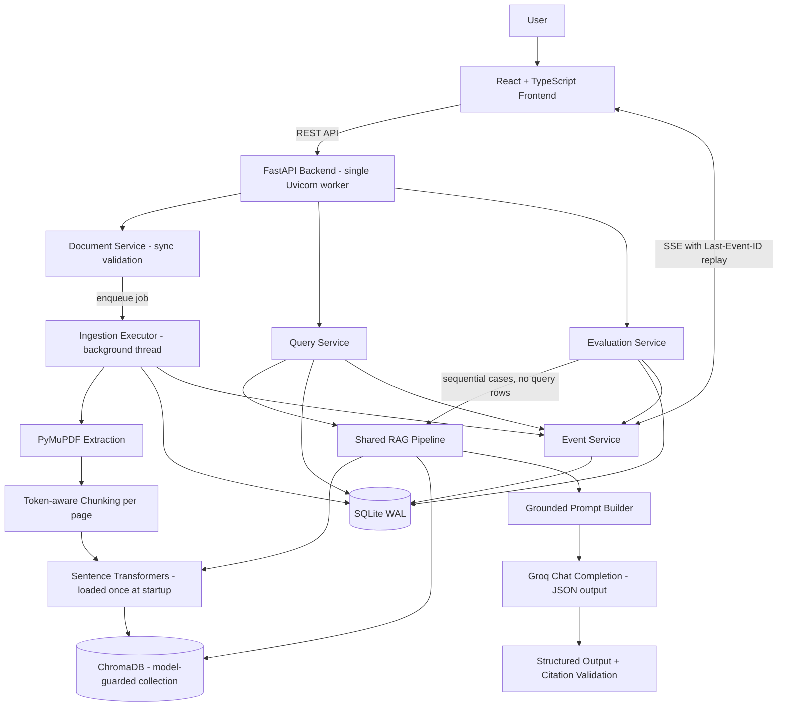

# Technical Requirements Document (TRD)

## AI-Powered Enterprise Document Retrieval & Evidence Assistant

| Field | Value |
|---|---|
| Document type | Technical Requirements Document |
| Version | 1.1 |
| Status | Baseline for POC development — revised 2026-11-16 (see `docs/07-DECISION-LOG.md`) |
| Architecture | React frontend + FastAPI backend + RAG services |

Status values, stage names, event shapes, error codes, evaluation categories, and API response shapes are defined once in `docs/04-BACKEND-SCHEMA.md`. This document references them rather than redefining them.

---

## 1. Technical overview

The application is a local-first, full-stack RAG proof of concept. The React frontend communicates with a Python FastAPI backend. The backend validates and stores PDF files, extracts text page by page, chunks text, generates embeddings locally with Sentence Transformers, stores vectors and metadata in ChromaDB, retrieves relevant chunks for a query, and calls Groq for LLM answer generation.

SQLite stores application metadata and job/query/evaluation records. Uploaded files are stored in a local data directory. Backend processing events are persisted in SQLite and exposed to the frontend using Server-Sent Events (SSE) with replay, so the UI timeline reflects actual execution status and recovers after refresh.

## 2. Architecture decisions

| Concern | Decision | Rationale |
|---|---|---|
| Frontend framework | React + TypeScript + Vite | Focused SPA for a local POC; typed components and fast development. |
| Styling | Tailwind CSS | Consistent responsive styling and token-driven design. |
| UI components | shadcn/ui | Accessible, customizable components owned by the project. |
| Animation | Motion for React (`motion`) | Page transitions, layout changes, and purposeful micro-interactions. |
| Animated extras | Selected React Bits components | Use selectively for an occasional visual effect; avoid making it the design foundation. |
| Icons | Lucide React | Consistent interface icons. |
| Charts | Recharts | Evaluation and dashboard charts. |
| Backend | Python + FastAPI | Typed API layer and Python ecosystem for document/AI processing. |
| PDF extraction | PyMuPDF | Page-oriented text extraction and page metadata. |
| Embeddings | Sentence Transformers, initial model `sentence-transformers/all-MiniLM-L6-v2` | Local embedding generation; no dependency on Groq for embeddings. |
| Vector database | ChromaDB, persistent local collection | Store/search embedded chunks and metadata. |
| LLM inference | Groq API with structured JSON output | Generate grounded responses from retrieved context; machine-checkable abstention and citations. |
| Metadata database | SQLite (WAL mode) | Simple local persistence for documents, pages, jobs, events, queries, feedback, and evaluation. |
| File storage | Local filesystem | Keeps the POC simple; relative storage paths are stored in SQLite. |
| Execution model | Single Uvicorn worker; in-process background executors (Python standard library) | Chroma persistent client and the in-process event bus require one process; CPU-heavy work stays off the event loop. |
| RAG orchestration | Explicit Python services; no LangChain/LangGraph unless a clear benefit is demonstrated and approved | Makes retrieval and prompting easy to explain and debug. |
| Conversation model | Each question is independent; no conversation memory in the MVP | Keeps grounding and evaluation unambiguous. |
| Browser validation | Playwright / Playwright MCP during development | Verify actual UI layout and user flows. |

## 3. High-level component architecture



The event service persists every event to `workflow_events` first, then notifies connected SSE subscribers. The SSE endpoints are served by the same FastAPI process.

## 4. Repository structure

```text
enterprise-document-retrieval-poc/
├── CLAUDE.md
├── README.md
├── docs/
│   ├── 01-PRD.md
│   ├── 02-TRD.md
│   ├── 03-UI-UX-BRIEF.md
│   ├── 04-BACKEND-SCHEMA.md
│   ├── 05-APP-FLOW.md
│   ├── 06-IMPLEMENTATION-PLAN.md
│   └── 07-DECISION-LOG.md
├── sample-corpus/        # committed synthetic/fictional PDFs (stable SHA-256 hashes)
├── evaluation/
│   └── datasets/         # committed versioned JSON seed datasets
├── frontend/
│   ├── package.json
│   ├── vite.config.ts
│   ├── .env.example
│   ├── src/
│   │   ├── app/
│   │   ├── components/
│   │   ├── features/
│   │   ├── hooks/
│   │   ├── lib/
│   │   ├── pages/
│   │   ├── services/     # typed API client + explicit mock adapter
│   │   ├── styles/
│   │   └── types/
│   └── public/
├── backend/
│   ├── app/
│   │   ├── api/
│   │   ├── core/         # settings, project-root path resolution, logging
│   │   ├── db/
│   │   ├── models/
│   │   ├── schemas/
│   │   ├── services/
│   │   ├── workers/      # background executors and startup recovery
│   │   └── main.py
│   ├── tests/
│   ├── requirements.txt
│   └── .env.example
├── data/                 # runtime only; never committed
│   ├── uploads/
│   ├── chroma/
│   └── app.db
└── .gitignore
```

The structure is a target, not a requirement to create every folder before it is needed. Keep implementation simple and avoid empty abstractions.

## 5. Frontend technical requirements

### 5.1 Application

- React with TypeScript and Vite.
- React Router or an equivalent lightweight router for the main application pages.
- Tailwind CSS, shadcn/ui, Motion for React, Lucide React, Recharts.
- A typed API client in one shared frontend service layer.
- `VITE_API_BASE_URL` sets the API base URL. It must never contain a secret.
- `VITE_API_MODE` selects `live` (real backend) or `mock` (explicit development adapter). Default `live`.
- Resolve `events_url` / `result_url` against the API origin with `new URL(path, VITE_API_BASE_URL)`.

### 5.2 Frontend pages

- `/dashboard` — summary metrics, recent documents, and recent queries.
- `/documents` — upload, list, search by filename, filter by status, and document detail with page diagnostics and processing timeline.
- `/assistant` — question input, answer, cited sources, retrieval details, query timeline, and query history.
- `/evaluations` — run evaluations, inspect metrics, review individual cases, and record human reviews.
- `/settings` — non-secret configuration display and backend/model health information.

Dark mode, document comparison, document-type filters, and PDF preview are stretch goals (see PRD §8).

### 5.3 Frontend state

- Use local component state for ephemeral UI state.
- Use a small shared store/context only where state is genuinely cross-page.
- Keep server data in API/query hooks and invalidate/refetch after mutations.
- Do not place secrets or backend-only configuration in Vite environment variables.
- Mock data is served only when `VITE_API_MODE=mock`. In mock mode the UI shows a persistent, visible "Mock data" indicator. Live mode must never fall back to mock data, including on API errors.
- Assistant questions are sent independently; the frontend never sends previous messages as context.

### 5.4 Accessibility and responsiveness

- Desktop-first dashboard, responsive down to tablet and mobile widths.
- Semantic HTML and accessible labels for inputs and buttons.
- Visible keyboard focus and keyboard-accessible dialogs/menus.
- Use status text/icons in addition to colour.
- Respect `prefers-reduced-motion`; provide reduced or no non-essential animation.
- Ensure charts have adjacent text summaries or accessible labels.

## 6. Backend technical requirements

### 6.1 Runtime

- Python 3.13, 64-bit CPython (approved; decision D-29, which supersedes D-22). Create the virtual environment explicitly with `py -3.13 -m venv backend/.venv`, not the machine's default interpreter. Tested patch version: 3.13.16.
- FastAPI with Pydantic request/response models and validated settings.
- Uvicorn for local serving, **single worker**.
- SQLite for metadata and persisted workflow-event history.
- ChromaDB `PersistentClient` and collection, with the tested `chromadb` version pinned (D-26).
- PyMuPDF for PDF validation and text extraction.
- Sentence Transformers for local embeddings.
- Groq Python SDK for chat completions.

Use compatible package versions and record the tested versions in the requirements file after installation. Do not guess future versions or mix incompatible major releases.

### 6.2 Service boundaries

- `document_service`: synchronous upload validation, storage, duplicate detection, metadata registration, reprocess, and deletion.
- `pdf_service`: page-by-page text extraction and page diagnostics (`document_pages`).
- `chunking_service`: token-aware, per-page chunk creation using the embedding model's tokenizer.
- `embedding_service`: one-time model loading, batch embedding, query embedding.
- `vector_store_service`: collection creation, model/dimension guard, add/query/delete vectors.
- `ingestion_job_runner`: executes queued document jobs in a background executor.
- `retrieval_service`: similarity retrieval, searchable-document filter, thresholding, context packing.
- `llm_service`: Groq request, prompt construction, structured-output parsing, provider error mapping.
- `citation_service`: validate source labels and build citations from retrieved chunk metadata.
- `rag_pipeline`: shared, non-persisting pipeline used by both queries and evaluations.
- `query_service`: orchestrate the user query lifecycle and persist query/retrieval records.
- `evaluation_service`: load seed datasets, run preflight, execute cases, calculate metrics, persist results and reviews.
- `event_service`: persist workflow events and notify SSE subscribers; replay by sequence.
- `startup_recovery`: recover interrupted jobs, queries, and evaluation runs at startup.

Services should be small and testable. Avoid a large single `main.py` or a monolithic route handler.

### 6.3 Execution model

- Run Uvicorn with exactly one worker. The ChromaDB persistent client and the in-process event notification are not shared across processes.
- Load the embedding model once in the FastAPI lifespan startup. Until it is loaded, `GET /health` reports `starting` and dependent endpoints return `503 SERVICE_NOT_READY`.
- Run CPU-heavy and blocking work (PDF extraction, chunking, embedding, ChromaDB calls, blocking Groq calls) outside the event loop:
  - document ingestion jobs run one at a time on a dedicated single-thread executor, in submission order;
  - each user query runs on a worker thread (for example via a thread-pool executor);
  - evaluation runs execute on a dedicated single-thread executor, one run at a time, with cases executed sequentially;
  - ingestion and evaluation never run at the same time (DD-02): an evaluation cannot start while any processing job is `queued` or `processing` (`409 INGESTION_IN_PROGRESS`), and uploads, reprocessing, and deletion are refused while an evaluation run is `queued` or `running` (`409 EVALUATION_IN_PROGRESS`).
- Use only Python standard-library concurrency (`concurrent.futures`, `asyncio`, `threading`). No external task queue or broker.
- SQLite: enable `PRAGMA journal_mode=WAL`, `PRAGMA foreign_keys=ON`, and a busy timeout. Use one connection per thread; keep write transactions short.
- Events are written to `workflow_events` before subscribers are notified (thread-safe hand-off to the event loop). SSE handlers replay from SQLite, so a missed notification never loses an event.
- Startup recovery, before accepting requests:
  - processing jobs in `queued` or `running` → `failed` with `JOB_INTERRUPTED`; their documents → `failed` with a message to use Reprocess; partially written vectors for those documents are deleted;
  - queries in `queued` or `running` → `failed` with `QUERY_INTERRUPTED`;
  - evaluation runs in `queued` or `running` → `failed` with `EVALUATION_INTERRUPTED`;
  - each recovered resource receives a persisted terminal event, so reconnecting clients see a truthful end state.
  Interrupted work is not restarted automatically; the user chooses to reprocess or rerun.

### 6.4 Embedding model guard

Store the embedding model ID and vector dimension in the ChromaDB collection metadata and on each document. On startup, compare them with the loaded model; on mismatch, enter the degraded state defined in `docs/04-BACKEND-SCHEMA.md` §4.1. Embeddings from different models must never be mixed in one collection.

## 7. Document ingestion pipeline

### 7.1 Synchronous (inside `POST /documents/upload`, before `202`)

1. Accept exactly one PDF per request (multipart). Multiple files are independent requests, documents, and jobs.
2. Stream the file to a temporary name in `UPLOAD_DIR`, enforcing `MAX_UPLOAD_SIZE_MB`.
3. Validate extension, `%PDF-` signature/MIME, and parseability (PyMuPDF opens it, not encrypted, ≥ 1 page).
4. Calculate SHA-256. If the hash already exists in `documents`, reject with `409 DUPLICATE_DOCUMENT` (the UNIQUE constraint also protects against simultaneous identical uploads).
5. Rename to a generated UUID storage name; never use the untrusted original path.
6. Create the `documents` row (`queued`) and a `processing_jobs` row (`queued`), persist the `validation` completed event, and enqueue the job.
7. Return `202` with `document_id`, `job_id`, and `events_url`.

Rejected files are removed and never create a document or job.

### 7.2 Background job

1. Mark the job `running` and the document `processing`.
2. `text_extraction`: extract text page by page with PyMuPDF; write one `document_pages` row per page with character, word, and token counts and `text_status` (`ok`, `low_text`, `no_text`) based on `MIN_PAGE_TEXT_CHARS`.
3. If no page has usable text, end the job `failed` with `NO_EXTRACTABLE_TEXT` and set the document to `needs_ocr`. OCR is not in the MVP. No vectors are written.
4. `chunking`: split text into overlapping, token-aware chunks **within each page** so every chunk has one unambiguous page number. Count tokens with the embedding model's tokenizer. Initial defaults: 220 tokens per chunk, 40 tokens overlap. Validate that chunk size plus special tokens fits the model's maximum sequence length (256 word pieces for `all-MiniLM-L6-v2`) so no silent truncation occurs.
5. `embedding_generation`: embed chunks in batches of `EMBEDDING_BATCH_SIZE`, publishing `completed_items` / `total_items`.
6. `vector_indexing`: store vectors with metadata (`document_id`, `chunk_id`, `filename`, `page_number`, `chunk_index`, `file_hash`, `embedding_model`, `created_at`).
7. Only after indexing succeeds, mark the job and document `completed`, or `completed_with_warnings` when any page is `low_text` or `no_text`.
8. On any failure, delete vectors already written for this job, mark the job `failed` with a stable error code, and set the document to `failed`.

Every stage publishes `started` and `completed`/`failed` events with timestamps, counts, and durations.

### 7.3 Reprocess and deletion

- `POST /documents/{id}/reprocess` re-validates the stored file, removes existing vectors and page rows, and **creates a new job** (`trigger: reprocess`, incremented `attempt_number`). Not allowed while `queued` or `processing`.
- `DELETE /documents/{id}` is a hard delete of file, vectors, and document metadata; it is not allowed while `queued` or `processing`. Query and evaluation snapshots are preserved. Partial failures are reported honestly (`delete_failed`). See `docs/04-BACKEND-SCHEMA.md` §5.3.

### 7.4 Initial configuration

| Setting | Initial value | Notes |
|---|---:|---|
| `CHUNK_SIZE_TOKENS` | 220 | Configurable; must fit within the embedder's maximum sequence length. |
| `CHUNK_OVERLAP_TOKENS` | 40 | Configurable; must be less than chunk size. |
| `RETRIEVAL_TOP_K` | 4 | Starting point for retrieval experiments. |
| `RETRIEVAL_MAX_DISTANCE` | Calibrate | Do not assume a universal threshold; calibrate against the labelled dataset. |
| `MIN_PAGE_TEXT_CHARS` | 30 (provisional) | Page-warning threshold; verify against the sample corpus. |

ChromaDB cosine distance is a distance value (lower is more similar). Keep distance semantics explicit in code and UI; do not label a raw distance as a similarity percentage.

## 8. Query and RAG pipeline

1. Validate the request (`docs/04-BACKEND-SCHEMA.md` §5.5) and confirm at least one searchable document exists (`409 NO_INDEXED_DOCUMENTS`).
2. Create a query record (`queued`), return `202`, and run the pipeline on a worker thread. Publish `query_received`.
3. `query_embedding`: embed the question with the same model used for document chunks.
4. `retrieval`: search ChromaDB with cosine distance for top-k candidates, restricted to searchable documents (and the optional `document_ids` filter). Persist every candidate in `query_retrievals`.
5. `context_preparation`: if `RETRIEVAL_MAX_DISTANCE` is configured, retain only candidates with distance ≤ threshold; otherwise retain all candidates and record `threshold_applied: false`. Optional duplicate/near-duplicate filtering may be applied.
6. If no candidates were returned or none were retained, finish with status `insufficient_evidence` (`no_retrieval_results` or `below_evidence_threshold`) **without calling the LLM**; `generation` and `citation_validation` are published as `skipped`.
7. Assign labels `S1…Sn` to retained chunks in rank order and build a prompt with grounding instructions and delimited, source-labelled passages.
8. `generation`: call Groq chat completion with the model from `GROQ_MODEL`, requesting the structured JSON output defined in `docs/04-BACKEND-SCHEMA.md` §7.2.
9. `citation_validation`: apply the validation rules in `docs/04-BACKEND-SCHEMA.md` §7.3. Only cited, validated labels become final citations; all retrieved candidates remain available as retrieval details.
10. Persist the answer, status, abstention reason, review flag/reasons, citation flags, token usage if available, and latency timings.
11. Publish the terminal event (`completed`, `insufficient_evidence`, or `failed`). The frontend then fetches `GET /queries/{id}`.

Insufficient evidence is a normal HTTP 200 result, not an API error. Each question is independent; no conversation history is included in the prompt.

When `RETRIEVAL_MAX_DISTANCE` is not yet calibrated, the LLM's `insufficient_evidence` flag and the uncited-answer rule are the only abstention gates. `GET /settings/status` and the query result expose `evidence_threshold_calibrated: false`, and the UI shows that notice.

### Grounding requirements

- The LLM must not rely on outside knowledge to fill gaps in the uploaded documents.
- Retrieved context is untrusted content. It must be treated as evidence, not as instructions to the model.
- Prompt-injection-like instructions found inside a PDF must not override system/developer instructions. The labelled dataset includes `prompt_injection` cases to test this.
- Citations must be constructed from backend retrieval metadata.
- An answer with no valid citations is not presented as grounded (it becomes `insufficient_evidence` with `no_valid_citations`).
- Flagged answers (`flag_for_review`) are returned with a visible review warning.

## 9. Groq integration

- Keep `GROQ_API_KEY` server-side only.
- Read `GROQ_MODEL` from backend configuration; do not hard-code a model ID in business logic. The initial model is `openai/gpt-oss-20b` (D-23).
- Use Groq Structured Outputs with the strict JSON Schema in `docs/04-BACKEND-SCHEMA.md` §7.2 when the configured model supports strict mode. If the smoke test shows it does not, use Groq's non-strict JSON Schema mode instead and record this in the decision log (DD-27). In both cases the backend validates every response with Pydantic and the §7.3 rules.
- `openai/gpt-oss-20b` is a reasoning model. Exclude reasoning output where the API allows, and never log, persist, or display reasoning content.
- Before the Phase 6 exit, confirm with a live smoke test that the configured model is available to the account and honours the strict schema. Record the result in the decision log.
- Use a conservative temperature (initially 0.1–0.2), configurable; confirm the configured model accepts it.
- Set connection/read timeouts and map authentication, rate-limit, timeout, provider, and invalid-response failures to the stable codes in `docs/04-BACKEND-SCHEMA.md` §10.1.
- Retry policy: evaluation cases make at most `GROQ_MAX_ATTEMPTS` (3) Groq attempts for transient failures (1 initial attempt + up to 2 retries). Before each retry, wait the exponential delay from `GROQ_RETRY_BASE_SECONDS` (1 s before attempt 2, 2 s before attempt 3). If the provider sends a `Retry-After` header, wait the longer of the two, so a retry never happens earlier than requested. If `Retry-After` is longer than `GROQ_MAX_RETRY_WAIT_SECONDS` (15), stop retrying that case at once and record it as `failed` with the last error code and `failure_type: infrastructure` (DD-24). Full rules: `docs/04-BACKEND-SCHEMA.md` §9.8. Interactive user queries fail fast without retries.
- Do not log API keys or full prompts containing document text.
- Groq is used for LLM inference only. It is not the embedding provider.

## 10. Evaluation requirements

### 10.1 Test dataset

- The labelled dataset is created during early project setup (Phase 0), together with the synthetic sample corpus, and is used to calibrate the evidence threshold.
- 15–20 labelled questions for the first iteration, expanding as needed.
- Stored as a versioned JSON seed file in `evaluation/datasets/` (format: `docs/04-BACKEND-SCHEMA.md` §8). Documents are identified by stable SHA-256 hashes of the committed files in `sample-corpus/`.
- Categories: `direct`, `multi_document`, `ambiguous`, `conflicting_documents`, `unanswerable`, `out_of_scope`, `prompt_injection`. The first dataset includes at least one case of each.
- Each case includes question, category, expected behaviour, expected answer and rubric criteria, expected `(document, page)` sources, optional `must_not_contain` strings, tags, and review notes.

### 10.2 Execution

- Preflight checks only the documents referenced by the selected dataset (its `evaluation_dataset_documents` rows). If any of them is missing or not fully indexed (`completed` or `completed_with_warnings`), the run is refused with `409 EVALUATION_CORPUS_INCOMPLETE`. Other indexed documents that the dataset does not reference do not block the run (DD-18). Retrieval still searches every searchable document, so extra documents can appear as retrieval candidates; this is expected and visible in the per-case retrieval details.
- Preflight also refuses a run while another run is active (`409 EVALUATION_ALREADY_RUNNING`) or while any processing job is active (`409 INGESTION_IN_PROGRESS`).
- Cases run sequentially through the shared `rag_pipeline`. Evaluation results are stored in `evaluation_results` and `evaluation_result_retrievals` and **never** in `queries`, so dashboard query statistics are not affected.
- A failed case is recorded with its own `execution_status` and error, and the run continues. The run ends `completed`, `completed_with_errors`, or `failed` as defined in the schema.
- Transient Groq failures get at most 3 attempts in total. If all 3 attempts fail, the case is marked `failed` with `failure_type: infrastructure` and excluded from quality metrics, with the count reported separately (`docs/04-BACKEND-SCHEMA.md` §9.8).

### 10.3 Metrics

Definitions are in `docs/04-BACKEND-SCHEMA.md` §9:

- Precision@k, Recall@k, and MRR at the unique `(document, page)` level (rule-based).
- Abstention correctness, citation source match, and prompt-injection checks (rule-based).
- Answer correctness, faithfulness, and citation validity from the in-app human review (human-reviewed).
- Retrieval, generation, and end-to-end latency (measured).

RAGAS and LLM-as-judge are optional stretch additions. If used, record the version, metric configuration, judge model, and sample count, and label values as automated estimates separate from human review.

## 11. Event and timeline requirements

Use SSE for one-way backend-to-frontend progress updates, following the common envelope and replay rules in `docs/04-BACKEND-SCHEMA.md` §6.

- Upload, reprocess, query, and evaluation requests return a resource ID and `events_url` promptly.
- The frontend subscribes to the event URL; every persisted event is replayed by sequence number on connect (`Last-Event-ID` header or `last_event_id` query parameter).
- The frontend updates the timeline only when an event is received.
- On completion or failure, the stream sends one terminal event and closes.
- Status endpoints (`GET /jobs/{id}`, `GET /queries/{id}`, `GET /evaluations/runs/{id}`) are the fallback when the event connection cannot be re-established.

Do not animate a stage to `completed` before the backend confirms success. A visual progress indicator may animate between actual events, but the displayed state must remain truthful.

## 12. Storage and data retention

- All backend data paths are resolved from the **project root** (the repository root), not from the process working directory. Relative values in `.env` are interpreted relative to the project root.
- Uploaded files live under `data/uploads/`, ChromaDB persistence under `data/chroma/`, and SQLite under `data/app.db`. These are excluded from Git.
- The synthetic sample corpus (`sample-corpus/`) and seed datasets (`evaluation/datasets/`) are committed so hashes are stable. They contain only fictional/public demonstration content.
- Deleting a document hard-deletes its file, vectors, page rows, jobs, and job events, and preserves query/evaluation snapshots.
- POC retention is local and manual. Do not claim secure enterprise retention or deletion guarantees.
- Demo reset procedure: stop the backend, delete `data/`, restart, and re-upload the sample corpus.

## 13. Security and privacy

- Put all credentials in `backend/.env`; commit only `.env.example` files with placeholders.
- Add `.env`, `data/`, logs, and Python/Node build artifacts and virtual environments to `.gitignore`.
- Restrict CORS to `FRONTEND_ORIGIN`. Open the frontend at exactly that origin during development.
- Enforce the configurable upload size limit and reject path traversal / unsafe filenames.
- Use generated UUIDs for file storage names.
- Never expose local file paths or storage names; return document IDs, safe display names, and file hashes.
- Never place a Groq key in `VITE_*` variables, local storage, browser code, or frontend network requests.
- Use only synthetic or public documents in the POC.

## 14. Error handling

All error responses use the standard shape in `docs/04-BACKEND-SCHEMA.md` §10 with the stable codes listed in §10.1. Background failures are recorded on the resource and in its terminal event rather than as HTTP errors.

Insufficient evidence is not an error.

Never return stack traces or secret-bearing configuration to the frontend.

## 15. Observability

Record durations for: validation and storage; text extraction; chunking; embedding; vector indexing; query embedding; vector retrieval; Groq generation; overall query; evaluation case and run.

Use the job, query, or run ID as the correlation ID. Logs contain IDs, stage names, counts, durations, and safe error codes, not API keys, prompts, or complete document contents.

## 16. Testing strategy

### Unit tests

- Upload validation order, duplicate rejection, and temporary-file cleanup.
- PDF page extraction, page-number retention, and `document_pages` warning classification.
- Chunk boundaries, overlap, per-page constraint, and token-limit validation.
- Embedding dimension, empty-input handling, and collection model guard.
- Chroma metadata persistence, searchable-document filtering, and deletion.
- Retrieval ranking and threshold/abstention behaviour (calibrated and uncalibrated).
- Structured-output parsing and every citation validation rule.
- Prompt construction with untrusted document content.
- Evaluation metric calculations, including deduplication and not-applicable handling.
- Seed dataset validation and checksum immutability.
- Path resolution from the project root.

### Integration tests

- Upload to indexed document (`completed` and `completed_with_warnings`).
- Image-only/no-text PDF to `needs_ocr`.
- Reprocess creates a new job; delete rules and partial-failure reporting.
- Query to retrieved context and generated answer (mock Groq).
- Unsupported query to `insufficient_evidence` with HTTP 200.
- SSE lifecycle: successful and failed jobs, terminal events, and `Last-Event-ID` replay.
- Startup recovery of interrupted jobs, queries, and runs.
- Evaluation run to stored results, `completed_with_errors`, and human review; confirm no `queries` rows are created.
- Evaluation retry policy with a mocked Groq client: transient errors get at most 3 attempts in total, retries never happen before `Retry-After`, a `Retry-After` over 15 s stops retrying, exhausted attempts produce `failure_type: infrastructure`, and non-retryable errors are not retried.

### Frontend / end-to-end tests

- Upload validation, independent multi-file upload, duplicate (409), and progress.
- Document listing, status labels, diagnostics, reprocess, and delete.
- Ask question, inspect citations and retrieval details, and open query history.
- Query failure, insufficient-evidence, and flagged-answer states.
- Run evaluation, open a per-case result, and submit a review.
- Mock-mode indicator visible only in mock mode.
- Keyboard, responsive, and reduced-motion checks.

Use deterministic local fixtures (generated with PyMuPDF, including a no-text PDF) and mocked LLM calls in automated tests. Live Groq calls are optional manual smoke tests.

## 17. Configuration variables

Backend `backend/.env.example` (no real secrets):

```dotenv
APP_ENV=development
API_HOST=127.0.0.1
API_PORT=8000
FRONTEND_ORIGIN=http://localhost:5173
LOG_LEVEL=INFO

GROQ_API_KEY=replace_me
GROQ_MODEL=openai/gpt-oss-20b
GROQ_TEMPERATURE=0.2
GROQ_TIMEOUT_SECONDS=45
GROQ_MAX_ATTEMPTS=3
GROQ_RETRY_BASE_SECONDS=1
GROQ_MAX_RETRY_WAIT_SECONDS=15

EMBEDDING_MODEL=sentence-transformers/all-MiniLM-L6-v2
EMBEDDING_BATCH_SIZE=32
CHUNK_SIZE_TOKENS=220
CHUNK_OVERLAP_TOKENS=40
MIN_PAGE_TEXT_CHARS=30
RETRIEVAL_TOP_K=4
RETRIEVAL_TOP_K_MAX=10
RETRIEVAL_MAX_DISTANCE=
QUERY_MAX_CHARS=1000

# Relative paths are resolved from the project root, not the working directory.
DATA_DIR=data
SQLITE_PATH=data/app.db
UPLOAD_DIR=data/uploads
CHROMA_PERSIST_DIR=data/chroma
CHROMA_COLLECTION_NAME=enterprise_document_chunks
EVALUATION_DATASET_DIR=evaluation/datasets
MAX_UPLOAD_SIZE_MB=20
SSE_HEARTBEAT_SECONDS=15
```

The application parses values into typed settings and resolves all paths against the project root (derived from the settings module location). `RETRIEVAL_MAX_DISTANCE` is intentionally blank until calibrated and is an optional numeric setting; an empty string must not be parsed as a float. `MIN_PAGE_TEXT_CHARS` is provisional and must be checked against the sample corpus.

Frontend `frontend/.env.example`:

```dotenv
VITE_API_BASE_URL=http://127.0.0.1:8000/api/v1
VITE_API_MODE=live
```

These are the only frontend variables. Neither may contain a secret.

## 18. Values to record during implementation

The decisions are made (`docs/07-DECISION-LOG.md` D-21 to D-28). The following values are measured or confirmed during implementation and recorded in the decision log's "Implementation-time calibration" table (§4):

- Exact Python 3.13 patch version and pinned library/Node package versions (Phase 1) — recorded: Python 3.13.16; see decision log §4.
- Live confirmation that `openai/gpt-oss-20b` is available and honours the strict schema, or that the non-strict fallback (DD-27) is needed (Phase 6).
- Calibrated `RETRIEVAL_MAX_DISTANCE`, its method, and the dataset version (Phase 6).
- Final `MIN_PAGE_TEXT_CHARS` from the synthetic corpus (Phase 4).
- Pinned `chromadb` version and its confirmed cosine/metadata API (Phase 4).
- Whether RAGAS or an LLM judge is added after the basic metrics work (stretch).
