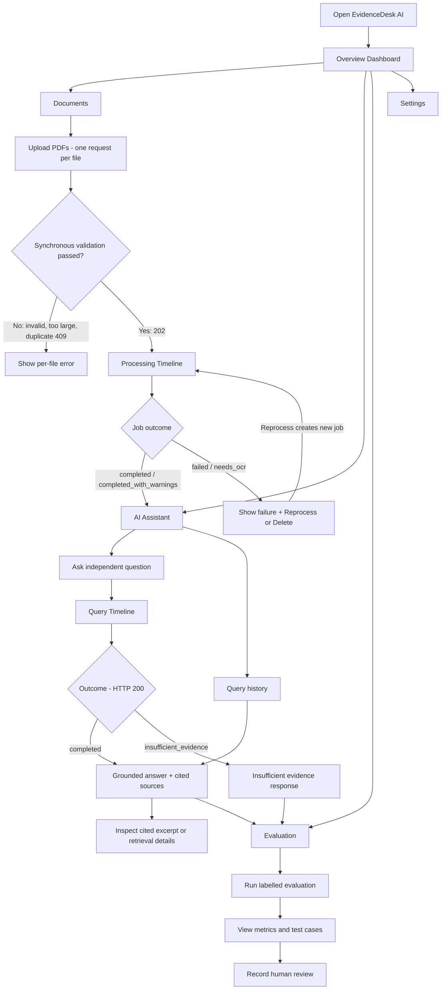
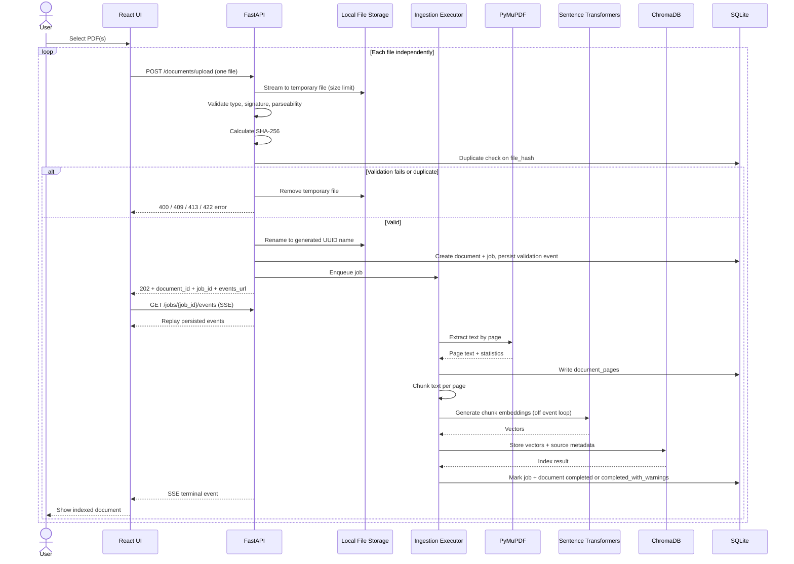
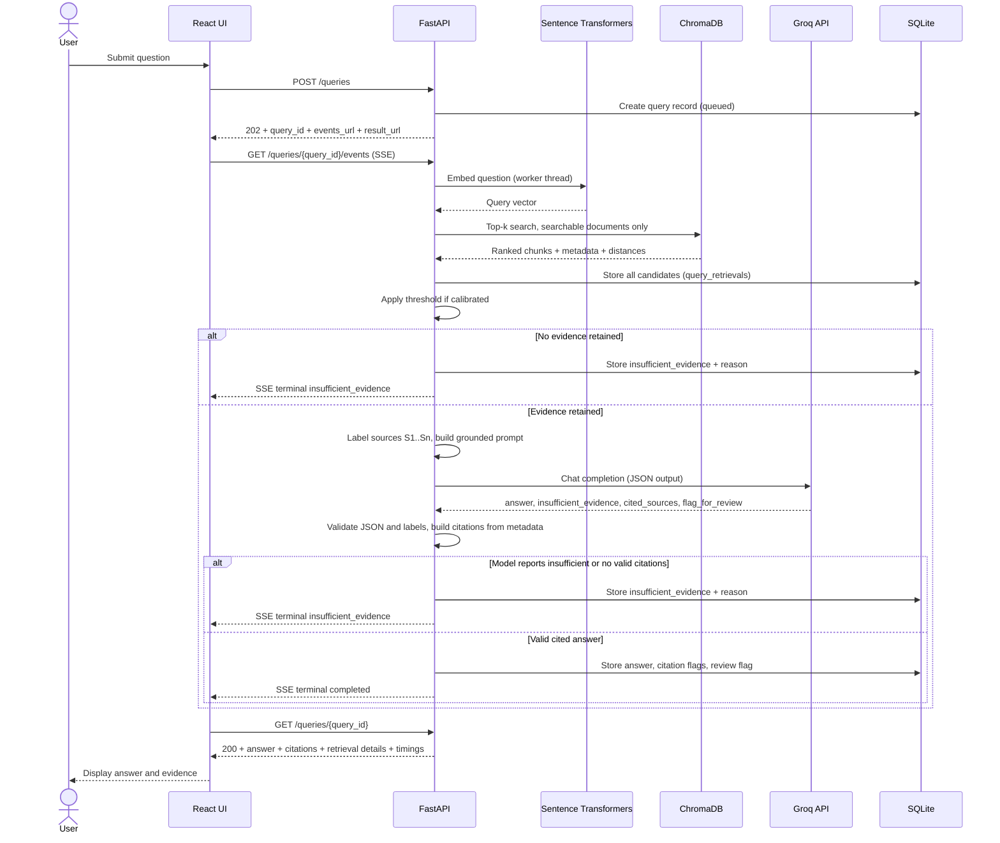
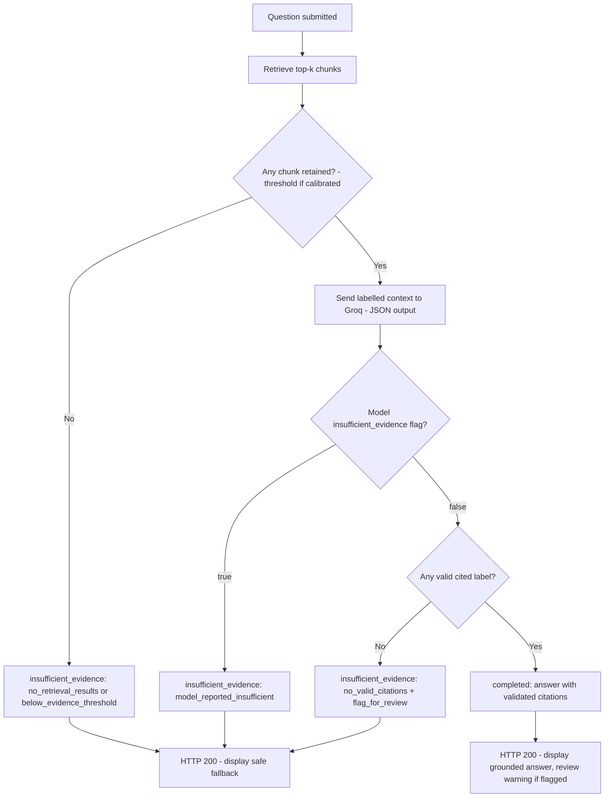
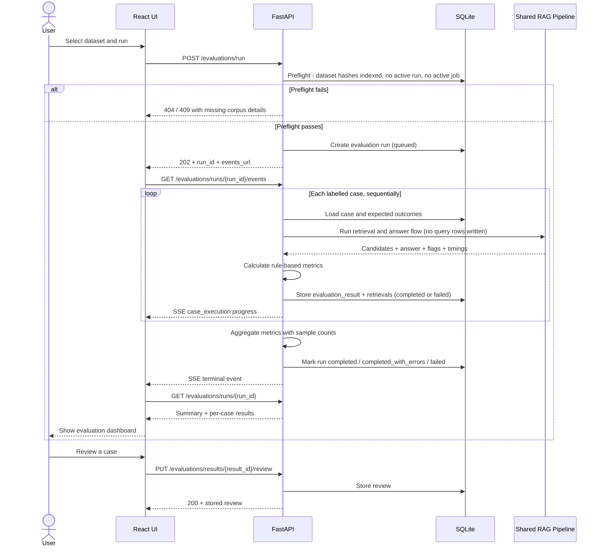

# Application Flow and User Journeys

## AI-Powered Enterprise Document Retrieval & Evidence Assistant

| Field | Value |
|---|---|
| Document type | Application flow / process design |
| Version | 1.1 |
| Status | Baseline for POC implementation — revised 2026-11-16 (see `docs/07-DECISION-LOG.md`) |

Status values, stage names, events, and error codes used below are defined in `docs/04-BACKEND-SCHEMA.md`.

---

## 1. Purpose

This document describes how users move through the application and how the frontend, backend, vector database, metadata database, and Groq LLM interact. It is intended to support implementation, UI design, testing, and the Business Analyst interview explanation.

## 2. Main navigation flow



## 3. Journey A — Upload a document

### User goal

Add a business PDF to the knowledge base so that it can be searched.

### Steps

1. User opens **Documents**.
2. User drags one or more PDFs into the upload area or selects them using the file browser.
3. Frontend performs basic checks (extension and configured size limit) for quick feedback.
4. Frontend sends **each file as a separate** `POST /api/v1/documents/upload` request. Each file succeeds or fails independently.
5. Backend performs authoritative validation **synchronously**: extension, size, PDF signature, SHA-256 duplicate check, and PyMuPDF parseability.
6. If validation fails, the backend returns an error (`400`, `409`, `413`, or `422`) and creates no document or job. A duplicate returns `409 DUPLICATE_DOCUMENT` identifying the existing document.
7. If validation passes, the backend stores the file under a generated name, creates the document (`queued`) and job (`queued`), records the `validation` stage as completed, and returns `202` with `document_id`, `job_id`, and `events_url`.
8. Frontend subscribes to `GET /api/v1/jobs/{job_id}/events`; persisted events are replayed from the start.
9. The background job runs the ingestion stages one at a time.
10. Frontend displays each received stage, status, and meaningful counts/durations.
11. On `completed` or `completed_with_warnings`, the document appears as indexed and is searchable. Warnings link to page diagnostics.
12. On `failed` or `needs_ocr`, the UI shows a safe error message and the available recovery actions (Reprocess, Delete).

### Upload flow



Each stage persists a `started` event and a `completed` or `failed` event before the UI is notified.

### Visible processing stages

| Stage | User-facing label | What it means |
|---|---|---|
| `validation` | Validated | Type, size, duplicate, and parseability checks passed (performed before the job is queued). |
| `text_extraction` | Extracting text | Reading text page by page and recording page statistics and warnings. |
| `chunking` | Preparing content | Dividing extracted text into overlapping chunks within each page. |
| `embedding_generation` | Generating embeddings | Converting text chunks into vectors locally. |
| `vector_indexing` | Indexing content | Saving vectors and source metadata in ChromaDB. |

Terminal outcomes: **Ready to search** (`completed`), **Ready with warnings** (`completed_with_warnings`), **Failed** (`failed`), **Needs OCR — not supported** (`needs_ocr`).

If a PDF contains no extractable text, show `needs_ocr`. Do not show a successful indexing state.

### Reprocess and delete

- **Reprocess** (available for `completed`, `completed_with_warnings`, `failed`, `needs_ocr`): calls `POST /documents/{id}/reprocess`, which creates a **new job**; the timeline shows the new attempt.
- **Delete** (with confirmation): calls `DELETE /documents/{id}`. Hard-deletes the file, vectors, and document metadata; past query and evaluation snapshots remain visible.
- Both actions are disabled with an explanation while the document is `queued` or `processing`.

## 4. Journey B — Ask a question

### User goal

Get a reliable answer to a business question and inspect its source evidence.

Each question is answered **independently**. Previous questions and answers are not used as context.

### Steps

1. User opens **AI Assistant**.
2. User enters a question, for example: "What approvals are required for a payment above the limit in the policy?"
3. Frontend sends the question to `POST /api/v1/queries`.
4. Backend validates it, creates a query record, and returns `202` with the query ID and event/result URLs.
5. Frontend subscribes to the query SSE endpoint.
6. Backend embeds the query and searches ChromaDB across searchable documents.
7. Backend applies the evidence threshold (if calibrated) and prepares labelled context.
8. If no evidence is retained, backend finishes with `insufficient_evidence` without calling Groq.
9. Otherwise, backend calls Groq and receives structured JSON output.
10. Backend validates the output and cited labels and builds citations from retrieved chunk metadata.
11. Frontend fetches `GET /api/v1/queries/{id}` (HTTP 200 for every outcome) and displays the answer, cited sources, retrieval details, and measured timings.
12. User can inspect a citation, open retrieval details, copy the response, submit feedback, or ask another question.
13. Past questions are listed from `GET /api/v1/queries` and can be reopened.

### Query flow



### Visible query timeline

| Stage | User-facing label | Evidence shown |
|---|---|---|
| `query_received` | Question received | Query accepted. |
| `query_embedding` | Embedding the question | Embedding step completed and duration; do not claim semantic understanding beyond the operation. |
| `retrieval` | Searching documents | Retrieved chunk count and duration. |
| `context_preparation` | Preparing supporting context | Evidence chunk count; whether a threshold was applied. |
| `generation` | Generating answer | Provider/model label and duration, or "Skipped". |
| `citation_validation` | Checking references | Number of validated citations, review flag, or "Skipped". |

Terminal outcomes: **Answer ready** (`completed`), **Insufficient evidence** (`insufficient_evidence`), **Failed** (`failed`).

Only show actual implemented stages. Do not show private chain-of-thought or hidden model reasoning. A timeline describes operations, not the LLM's internal reasoning process.

### Citations vs retrieval details

- **Cited sources** show only chunks whose labels the answer cited and the backend validated.
- **Retrieval details** list all retrieved candidates in rank order with raw distance, whether each passed the threshold, and whether it was cited.
- If a source document was deleted later, its snapshot is still shown and marked "Document no longer available".

## 5. Journey C — Unsupported question

### Example

User asks: "What was the company's revenue in 2022?" The uploaded documents do not contain revenue information.

### Expected behaviour

1. Retrieval returns no sufficiently relevant evidence, the threshold is not met, or the model reports insufficient evidence.
2. The backend does not ask the LLM to invent an answer, and does not present an uncited answer as grounded.
3. Query status becomes `insufficient_evidence` with an abstention reason. The result is returned with HTTP 200.
4. UI displays: "I couldn't find enough supporting information in the indexed documents to answer this question. Try another question or upload a relevant document."
5. No citation is displayed; retrieval details remain available for inspection.
6. Equivalent cases exist in the labelled dataset as `unanswerable` and `out_of_scope` abstention tests.



## 6. Journey D — Evaluate the system

### User goal

Understand whether the application retrieves the right sources and generates reliable answers.

### Steps

1. User opens **Evaluation**.
2. User selects the labelled dataset (loaded from the versioned JSON seed file) or uses the default.
3. The page shows whether every document **referenced by this dataset** is fully indexed. If not, it lists the missing files and the run action is disabled with an explanation. Other uploaded documents do not block the run. While a document is being processed, the run action is disabled with "Wait for document processing to finish".
4. User clicks **Run evaluation**.
5. Frontend calls `POST /api/v1/evaluations/run`; preflight confirms the dataset's documents are indexed, no other run is active, and no processing job is active.
6. Backend creates an evaluation run and returns a run ID and event URL.
7. Frontend subscribes to the evaluation SSE stream.
8. Backend runs each case sequentially through the shared RAG pipeline. These executions are **not** stored as user queries and do not affect dashboard statistics.
9. Backend calculates rule-based metrics per case and stores the result, including retrieved excerpts, execution status, and any error.
10. Backend aggregates metrics with sample counts and finishes the run `completed`, `completed_with_errors`, or `failed`.
11. UI displays metrics, sample counts, scoring methods, latency, and per-case detail.
12. A reviewer opens a case and records correctness, faithfulness, citation validity, and a comment. Human-review aggregates update with the reviewed count.

### Evaluation flow



### Evaluation categories

Defined in `docs/04-BACKEND-SCHEMA.md` §2.8:

| Category | Expected behaviour |
|---|---|
| `direct` — fact clearly stated in one document (tag `paraphrase` for different-wording cases) | Answer |
| `multi_document` — answer needs more than one document | Answer |
| `ambiguous` — question is underspecified | Qualified answer stating the ambiguity |
| `conflicting_documents` — documents disagree or one is outdated | Qualified answer surfacing both sources without choosing an authoritative version |
| `unanswerable` — in-domain, but not in the corpus | Abstain |
| `out_of_scope` — unrelated to the corpus domain | Abstain |
| `prompt_injection` — embedded instructions in a document or question | Answer from evidence or abstain; never follow the injected instruction |

### Metric presentation rules

- Show metric name, value, denominator/sample count, and method.
- Separate rule-based, human-reviewed, and measured values; label any LLM-judge output (stretch) as an automated estimate.
- Mark metrics as N/A when a case has no usable ground truth.
- Show per-case examples so users can inspect failures.
- Never present an unsupported single "AI accuracy" number.

## 7. Document comparison flow (stretch)

1. User selects two indexed documents.
2. User chooses a comparison objective, such as payment thresholds, approval roles, or policy changes.
3. Backend retrieves relevant chunks from both documents.
4. Groq produces a structured comparison grounded in the two sources.
5. Backend maps each comparison point to source citations from the retrieved chunks.
6. UI displays a comparison table with source references on both sides.

If the two documents are not comparable or evidence is incomplete, the result must state that limitation. Do not imply semantic version control or automatically decide which policy is authoritative. The API contract for comparison is defined when the stretch phase begins.

## 8. Application states and transitions

### Document status

```text
                     ┌──────────────── reprocess (new job) ───────────────┐
                     v                                                     │
upload (validated) -> queued -> processing -> completed ───────────────────┤
                                           -> completed_with_warnings ─────┤
                                           -> failed ──────────────────────┤
                                           -> needs_ocr ───────────────────┘

any terminal status -- delete --> (removed)
                               -> delete_failed -- delete retry --> (removed)
```

Delete and reprocess are not allowed while `queued` or `processing`.

### Processing job status

```text
queued -> running -> completed
                  -> completed_with_warnings
                  -> failed            (including JOB_INTERRUPTED on restart)
```

Job stages (`validation`, `text_extraction`, `chunking`, `embedding_generation`, `vector_indexing`) are recorded separately in the job event history.

### Query status

```text
queued -> running -> completed
                  -> insufficient_evidence
                  -> failed            (including QUERY_INTERRUPTED on restart)
```

### Evaluation run status

```text
queued -> running -> completed
                  -> completed_with_errors
                  -> failed            (including EVALUATION_INTERRUPTED on restart)
```

## 9. Business process: AS-IS and TO-BE

### AS-IS: Manual document retrieval

1. Business user receives an operational or audit question.
2. User identifies likely folders or systems containing relevant documents.
3. User opens multiple PDFs/files and searches manually.
4. User compares passages and determines which version is relevant.
5. User copies the answer and manually records its source.
6. User may repeat the search if evidence is incomplete.

Potential pain points: repeated searching, inconsistent source capture, dependence on familiarity with document locations, and manual effort.

### TO-BE: AI-assisted evidence retrieval

1. Documents are indexed into a controlled POC knowledge base.
2. Business user asks a natural-language question.
3. System retrieves candidate passages semantically.
4. LLM drafts an answer using retrieved passages only.
5. System attaches validated source document/page/excerpts.
6. User verifies evidence and uses the answer as an aid, not as an autonomous approval or audit conclusion.
7. Evaluation results help identify retrieval and answer-quality gaps.

The POC should measure the time taken in both processes on the same labelled questions (a manual timed study outside the application) before claiming any reduction in manual effort.

## 10. Failure and recovery paths

| Failure | UI behaviour | Backend behaviour |
|---|---|---|
| Invalid file type | Per-file validation message | `400 INVALID_FILE_TYPE`; no document or job created. |
| File too large | Show configured limit | `413 FILE_TOO_LARGE`; no document or job created. |
| Duplicate file | "Already uploaded" with link to existing document | `409 DUPLICATE_DOCUMENT` with existing document ID. |
| Unparseable/encrypted PDF | Per-file validation message | `422 PDF_PARSE_FAILED`; no document or job created. |
| No text extracted | "Needs OCR — not supported in this POC" | Job `failed` with `NO_EXTRACTABLE_TEXT`; document `needs_ocr`; no vectors. |
| Some pages low/no text | "Indexed with warnings" + page diagnostics | Document `completed_with_warnings`; `document_pages` warnings. |
| Embedding model unavailable at startup | Backend status "Starting" or error in Settings | `503 SERVICE_NOT_READY`. |
| Embedding model mismatch | Settings shows mismatch and reset guidance | `503 EMBEDDING_MODEL_MISMATCH`; vectors never mixed. |
| Embedding failure during a job | Failed stage + Reprocess | Job `failed` with `EMBEDDING_FAILED`; partial vectors removed. |
| ChromaDB unavailable | Retry message | Resource `failed` with `VECTOR_STORE_UNAVAILABLE`; correlation ID preserved. |
| Server restarted mid-job/query/run | Timeline shows "Interrupted" terminal state + Reprocess / ask again / rerun | Startup recovery marks `JOB_INTERRUPTED` / `QUERY_INTERRUPTED` / `EVALUATION_INTERRUPTED`. |
| Groq rate limit | Temporary provider error | Query `failed` with `GROQ_RATE_LIMITED`; no answer reported. |
| Groq timeout | Timeout state and "Ask again" action | Query `failed` with `GROQ_TIMEOUT`. |
| Invalid LLM output | Provider error state | Query `failed` with `LLM_RESPONSE_INVALID`. |
| SSE connection drops | "Reconnecting…" state | Browser reconnects with `Last-Event-ID`; server replays missed events; status endpoint fallback. |
| Insufficient evidence | Fallback response and upload/refine suggestion | HTTP 200, status `insufficient_evidence`; no citation. |
| Delete while processing | Delete disabled with reason | `409 DOCUMENT_BUSY`. |
| File removal fails during delete | "Deletion incomplete — retry" | Document `delete_failed`; `result: partially_deleted`. |
| Evaluation corpus not indexed | Missing files (referenced by this dataset) listed; Run disabled | `409 EVALUATION_CORPUS_INCOMPLETE`. |
| Run evaluation while a document is processing | Run disabled: "Wait for document processing to finish" | `409 INGESTION_IN_PROGRESS`. |
| Upload, reprocess, or delete during an evaluation run | Controls disabled: "Evaluation run in progress" | `409 EVALUATION_IN_PROGRESS`. |
| Transient Groq error during an evaluation case | Case shows "Retrying (attempt n of 3)" | At most 3 attempts in total (waits of 1 s and 2 s, or longer if `Retry-After` asks; a `Retry-After` over 15 s stops retrying); if all attempts fail or retrying stops, the case is `failed` with `failure_type: infrastructure` and excluded from quality metrics. |
| Evaluation case fails | Case marked failed with error and failure type | Case `execution_status: failed` with `failure_type` `infrastructure` or `pipeline`; run continues and ends `completed_with_errors`. |
| Run evaluation in mock mode | Run disabled: "Mock mode cannot run evaluations: results are never simulated" | No request is sent (DD-40). |
| Answer has no inline `[Sx]` markers | Answer text shown without per-claim links; validated sources still shown as cited cards | Citations built from validated `cited_sources` labels (DD-46). |

Observed in the first live evaluation run (2026-11-17): Groq rate limits caused retries in 11 of 20 cases. One case (AP-UN-001) stopped after its first attempt with `GROQ_RATE_LIMITED` because `Retry-After` was over 15 s, and ended as an infrastructure failure; it was excluded from metrics and counted separately, as designed.

## 11. Interview explanation

A concise process explanation:

"The user uploads business documents. The backend validates each file, extracts page-level text, divides it into chunks, converts those chunks into embeddings locally, and stores them in ChromaDB. When the user asks a question, we embed the query, retrieve relevant passages, and pass those labelled passages as context to Groq, which returns a structured answer. The backend validates which sources were cited and builds the citations from the retrieved metadata, not from model-generated assumptions. If the evidence is insufficient, the system abstains. The UI shows the actual processing stages, and a separate evaluation module measures retrieval quality, abstention, citation support, human-reviewed correctness and faithfulness, and latency."
